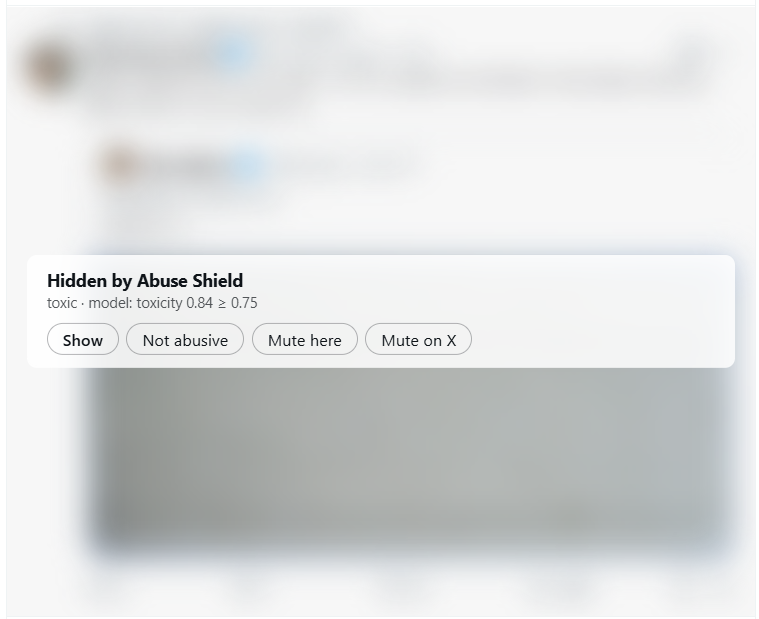
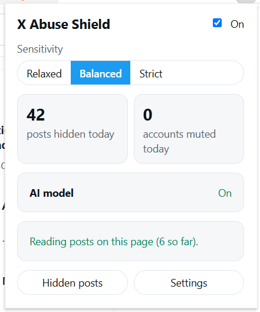
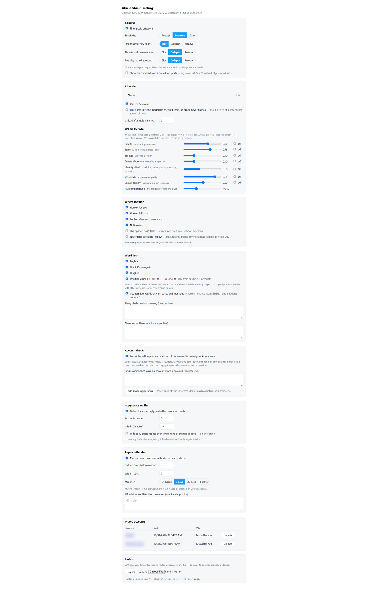

# X Abuse Shield

On-device, multilingual abuse filter for x.com. Scores posts with
[`Horizon-Labs/multilingual-toxicity-small`](https://huggingface.co/Horizon-Labs/multilingual-toxicity-small)
via Transformers.js, plus word lists, and hides or blurs abusive posts and authors.

[](https://addons.mozilla.org/en-US/firefox/addon/x-abuse-shield/)
[](https://github.com/downlz/x-abuse-shield/releases/latest)

## Install

**Firefox, desktop and Android:** install from **[Firefox Add-ons](https://addons.mozilla.org/en-US/firefox/addon/x-abuse-shield/)**. It's signed by Mozilla, stays installed and updates itself. On Android, open the link in Firefox for Android.

**Chrome or Brave:** download the latest version from **[Releases](https://github.com/downlz/x-abuse-shield/releases/latest)**:

- **Chrome or Brave:** `x-abuse-shield-<version>-chrome.zip`. Unzip it into a folder you'll keep, open `chrome://extensions` (or `brave://extensions`), switch on **Developer mode**, click **Load unpacked** and choose that folder.
- **Firefox without Add-ons** (e.g. testing a build): `x-abuse-shield-<version>.xpi` from the release, via `about:debugging#/runtime/this-firefox` → **Load Temporary Add-on…**. It's removed when Firefox quits; the Add-ons version is the one to keep.
- The `.crx` is for computers where a policy allows the extension: Chrome on Windows and macOS doesn't install `.crx` files from outside the Chrome Web Store.

Each release page has the full instructions and SHA-256 checksums. The extension is about 7 MB: the AI model is downloaded once, from [Hugging Face](https://huggingface.co/downlz/x-abuse-shield-model), when you turn it on in the popup — 289 MB on a computer, 93 MB on a phone (a lighter model for English, Hindi, Hinglish, Urdu and Bengali). The word lists work without it.

## Screenshots

<table>
  <tr>
    <td valign="top" width="50%">
      <br>
      <sub>A hidden post: why it was hidden, and what you can do about it.</sub>
      <br><br>
      <br>
      <sub>The popup: sensitivity, today's counts, model status and whether the page can be read.</sub>
    </td>
    <td valign="top" width="50%">
      <br>
      <sub>Settings. Every threshold and rule can be changed.</sub>
    </td>
  </tr>
</table>

## Goal

Stop throwaway, paid and coordinated troll accounts from bullying you on X. These accounts pile into replies with insults, threats and slurs, often in Hindi or Hinglish, and often from accounts created days earlier. The goal is to catch them on their first post, without your having to know who they are in advance and without hiding legitimate disagreement.

Abuse Shield judges both **what a post says** and **who is saying it**, entirely in your browser.

## Features

**Reading what a post says**
- An AI model gives 7 separate scores per post: toxicity, severe toxicity, threat, insult, identity attack, obscenity, sexual content. Each has its own threshold.
- It covers 34 languages, with built-in word lists for English, Hindi (Devanagari) and Hinglish.
- Disguised spellings are decoded before matching: `f*ck`, `fuuuck`, leetspeak.
- Mild words such as *pagal* or *gadha* only count when the model also finds the post toxic, so friendly teasing passes.
- Threat and extortion phrases are caught even without bad words ("I know where you live"). Harmless idioms ("kill it at your interview") are ignored.
- Emoji insults count too: 🖕 on its own, 🤡 and 💩 only in replies from suspicious accounts. (The model barely reacts to emoji.)
- Long posts are read in full, including the text behind "Show more".
- A quoted post is judged on its own: if only the quote is abusive, only the quote is hidden.

**Looking at who is posting**
- Account signals: account age, follower count, following-to-follower ratio, default avatar, auto-generated handles like `rahul12345678`, and your own bio keywords.
- Copy-paste brigades: the same or near-identical reply from 3 or more accounts within 10 minutes is grouped. If one copy is abusive, every copy is hidden.
- Suspicious accounts face stricter thresholds. A 9-day-old, 12-follower account gets flagged for an insult that an established account would not. Account signals never hide a clean post on their own.

**Dealing with repeat offenders**
- Strikes: 3 flagged posts in 7 days mutes the author automatically, for 24 hours, 7 days, 30 days or forever.
- Muted authors are hidden everywhere: For you, Following, replies, Notifications and quotes. Their reposts are hidden too.
- An optional "Mute on X" button, which you click yourself.

**Staying fair and in control**
- By default posts are blurred with click-to-reveal; threats and severe abuse are collapsed. Nothing is deleted or blocked on X.
- A review log shows why each post was hidden: scores, matched words, account reasons, and other members of a copy-paste group. From there you can mark a post "Not abusive", unmute or allowlist.
- Relaxed / Balanced / Strict presets, per-category sliders, custom word lists, and import/export of your settings.
- Accounts you follow never count as suspicious, and an option leaves them unfiltered altogether.
- Placeholders follow X's Default, Dim and Lights out themes.

**Private and fast**
- Everything runs on your device. The only network call is the one-time model download (~289 MB), and there's none when the model ships inside the extension. Account data is read from what X already sends to the page, so the extension makes no extra requests.
- Word-list, account and copy-paste checks run before a post appears on screen, so abuse doesn't flash. Model scoring takes about 28 ms per post.
- The model loads only while an x.com tab is open and unloads after 5 idle minutes. A word-list-only mode is available for low-memory devices.

## How it compares

Most current tools for X fall into two groups: **block-list tools** (block the accounts you pick, or import a list, e.g. [Twitter Blocker](https://chromewebstore.google.com/detail/twitter-blocker/mbjkhjgpomohfcodieeokjniidffmcga)) and **rule-based filters** (hide posts matching keywords, regex or account rules you write, e.g. [Twitter Filter](https://chromewebstore.google.com/detail/twitter-filter/ejhilomfbamkbfehkjbhemkpaghpcglj)).

| | Block-list tools | Rule-based filters | X Abuse Shield |
|---|---|---|---|
| Decides by | Accounts you choose | Rules you write | What the post says + who posted it |
| Catches an abuser you've never seen | No | Only if a rule happens to fit | Yes, on their first post |
| Understands meaning, not just keywords | No | No | Yes, 7 abuse categories |
| Hindi and Hinglish abuse | — | Only the words you add | Built-in word lists + model |
| Detects copy-paste brigades | No | No | Yes |
| Combines account signals with abuse scores | No | Separate rules | Yes, suspicious accounts face stricter thresholds |
| Repeat offenders | Manual | Manual | Automatic strikes → timed mute |
| Reversible | Blocks are permanent until undone | Depends on the rule | Blur by default, review log, one-click "Not abusive" |
| Automates actions on your X account | Yes (bulk blocking) | Optional auto-block | No; muting is local, and "Mute on X" is clicked by you |

Why that matters:
- **Trolls rotate accounts.** Block lists and handle rules fall behind as soon as a new account appears. Reading the post itself does not.
- **Abuse is often mild-sounding or in Hinglish.** Keyword rules miss "I know where you live" and need someone to write every slur variant. The model and the built-in lists cover these out of the box.
- **Brigades are the pattern, not one post.** Spotting the same reply from several new accounts catches organised campaigns that look harmless one post at a time.
- **Your account stays safe.** Nothing is automated against X, so there's no bulk-blocking behaviour that could get your account flagged.

What Abuse Shield doesn't do: it doesn't block accounts on X or bulk-import block lists. Block-list tools remain the right choice for that, and they work alongside this extension.

## Delivered recently

- ✅ **Firefox for Android** (0.2.5): the same Firefox add-on on phones, with touch-sized controls, compact hidden-post panels with icon buttons (0.2.6) and x.com's phone layout. [Firefox Add-ons](https://addons.mozilla.org/en-US/firefox/addon/x-abuse-shield/).
- ✅ **A smaller, lighter model for phones** (0.2.5): the vocabulary trimmed to English, Hindi, Hinglish, Urdu and Bengali and the layers stored as 8-bit integers — a 93 MB download instead of 289 MB and about 330 MB of memory instead of about 630 MB. Scores in those five languages change for 0.5–1.8% of posts.

## Planned features

- **The lighter model on desktop too**, as an option for computers with less memory.
- **Safari on iPhone and iPad.** A Safari build of the extension, with word lists only or the model running in the companion app if iOS memory limits are too tight.
- **Edge and Opera.** Builds tested on both browsers.
- **Mutes across devices.** Import/export works today; later, "Mute on X" so mutes sync through X itself.
- **Flag a visible post as abusive** directly on x.com, instead of through "Add a missed post" on the review page.

Details and progress are in [docs/PLAN.md](docs/PLAN.md).

## Build from source

```sh
npm install             # also copies ONNX Runtime's wasm into public/ort and generates WXT types
npm run model:build     # downloads the model once, converts it to run in place → public/models (~300 MB)
npm run model:trim      # the smaller phone model (Firefox for Android) → public/models; needs Python 3 (docs/ANDROID.md)
npm run build           # Chrome / Brave → .output/chrome-mv3
npm run build:firefox   # Firefox 128+   → .output/firefox-mv2
```

`model:build` is optional but recommended: the converted model ships inside the extension and needs far less memory (see below). Without it, the extension downloads the original model on first use instead.

**Chrome or Brave:** `chrome://extensions` (or `brave://extensions`) → enable **Developer mode** → **Load unpacked** → pick `.output/chrome-mv3`.

**Firefox:** `about:debugging#/runtime/this-firefox` → **Load Temporary Add-on…** → pick `.output/firefox-mv2/manifest.json`. A temporary add-on is removed when Firefox restarts. To keep it, have Mozilla sign it as an unlisted add-on (see [docs/STORE.md](docs/STORE.md)); signing needs the hosted model below, since Firefox Add-ons accepts files up to 200 MB.

Reload any open x.com tabs afterwards — extensions only run on pages opened after they load.

The toolbar popup shows the sensitivity preset, today's counts, the AI model's status and whether the extension can read the current tab. **Settings** covers everything else.

Each hidden post has **Show**, **Not abusive**, **Mute here** and **Mute on X** buttons. **Hidden posts** in the popup opens the review page: why each post was hidden, your labels, mutes and allowlist, and **Export labelled posts** for calibration.

The word lists work straight away. To add the AI model, click **Turn on** in the popup (or **Download (289 MB)** if the model isn't shipped). It loads while x.com is open — about 500 MB of memory with the converted model, 850 MB with the original one — and unloads after 5 idle minutes; scoring takes about 30 ms per post. Firefox runs it on a single thread (extensions there can't use shared memory), with similar end-to-end speed in tests.

### Where the model comes from

| Build | Extension size | First use | Memory while loaded (measured in Chrome) |
|---|---|---|---|
| `model:build`, then build (default) | ~331 MB | Nothing to download | ~500 MB |
| Hosted (releases): `WXT_BUNDLE_MODEL=false WXT_MODEL_URL=https://…/` | ~28 MB | Downloads the converted model once (289 MB) | ~500 MB |
| Neither | ~28 MB | Downloads the original model from Hugging Face (289 MB) | ~850 MB |

The browser can't do the conversion itself (ONNX Runtime's web build has no converter), so a small extension with the low-memory model needs the converted files hosted somewhere. Releases use [downlz/x-abuse-shield-model](https://huggingface.co/downlz/x-abuse-shield-model) on Hugging Face (`HOSTED_MODEL_URL` in `src/adapters/inference/model.ts`): a copy of `public/models/` with its folder structure.

## Tests

```sh
npm test                    # unit + fixture tests (Vitest, happy-dom)
npm run test:e2e            # builds, then runs the extension in Chrome for Testing against fake x.com pages
npm run test:e2e:firefox    # the same in your installed Firefox (FIREFOX_PATH to point elsewhere)
npm run test:e2e:hosted     # builds without the model and serves it from a local "model host" (add -- --firefox)
npm run test:e2e:mobile     # Firefox emulating a phone: Android user agent, touch, 412 px screen, the lite model
npx tsx scripts/e2e-smoke.ts --idle   # also checks the idle unload (adds ~2 minutes; --firefox works too)
```

The x.com fixtures in `tests/fixtures/` are synthetic, modelled on X's markup and API responses. The end-to-end run checks word-list verdicts in `requestAnimationFrame`, i.e. before the browser paints, loads the real model into a fresh profile to check model verdicts and their latency, and saves screenshots to `spike/results/e2e/` (`e2e-firefox/` for Firefox, which can't screenshot extension pages).

## Releasing

```sh
npm version <x.y.z> --no-git-tag-version   # then commit and push
npm run release                            # checks the model host, then builds .output/release/: Chrome .zip and .crx, Firefox .xpi, SHA256SUMS.txt
npx tsx scripts/e2e-smoke.ts --firefox --extension=.output/release/x-abuse-shield-<x.y.z>.xpi   # test a download (fetches the real model)
npm run release:publish -- --notes docs/releases/v<x.y.z>.md   # GitHub release tagged v<x.y.z> at the current commit
```

The `.crx` is signed with `~/.x-abuse-shield/crx-key.pem` (or `CRX_KEY`), created on the first release. Back it up and keep it out of the repository: it fixes the extension's id, and every later `.crx` must be signed with it. Publishing uses `GITHUB_TOKEN`, or else the GitHub credential git already has.

## Calibration

```sh
npm run calibrate   # scores labelled posts with word lists + model → docs/CALIBRATION.md
```

Label posts on the review page, click **Export labelled posts**, and save the file as `calibration/posts.jsonl` (git-ignored). The format is in [calibration/README.md](calibration/README.md).

## Phase 0 spike

Measures model load time, latency, memory and output parity inside the extension.

```sh
npm run spike:reference   # scores spike/samples.json on onnxruntime-node (downloads the model once)
npm run spike:browser     # builds, then runs the spike page in Chrome for Testing (headless)
npm run spike:report      # writes docs/SPIKE-REPORT.md
```

Memory comparisons of ONNX Runtime session settings (variants in `src/spike/variants.ts`), on the already-cached profile:

```sh
npx tsx scripts/spike-browser.ts --variant=ort-arena
```

To run it by hand in your own Chrome, open `chrome-extension://<extension id>/spike.html` and click **Run spike**.

## Capturing x.com fixtures

Extractor tests run against saved copies of X's markup. With the extension loaded:

1. Open x.com and scroll until a few posts are on screen.
2. Press **Alt+Shift+S**. The main column downloads as `x-<context>-<timestamp>.html`.
3. Capture at least: the **For you** tab, the **Following** tab, and an opened post with replies.
4. Move the files into `tests/fixtures/x/`.

Fixtures contain the posts that were on screen, so don't publish them.

## Layout

| Path | What |
|---|---|
| `src/core/` | Platform-neutral engine: word lists, decisions, account suspicion, copy-paste clusters, strikes and mutes, settings. Reused by the mobile ports |
| `src/adapters/inference/` | The model (in-place `.ort` or Transformers.js), and where it runs: Chrome's offscreen document or Firefox's background worker |
| `src/adapters/x-dom/` | Everything that touches x.com's DOM; all selectors in `selectors.ts` |
| `src/adapters/x-api/` | Reads the account and post data X fetches for itself; all field paths in `fields.ts` |
| `src/adapters/storage/` | `chrome.storage` layout |
| `src/entrypoints/` | Content scripts (`x.content/`, MAIN-world `x-api.content.ts`), background, popup, options, offscreen document (Chrome), model worker (Firefox), spike page (Chrome) |
| `src/ui/` | Shared React hooks, controls and theme for the popup and settings |
| `scripts/` | Spike runners, end-to-end smoke test, build helpers |

## License

[MIT](LICENSE). The bundled model, [`Horizon-Labs/multilingual-toxicity-small`](https://huggingface.co/Horizon-Labs/multilingual-toxicity-small), is licensed separately under Apache-2.0.
